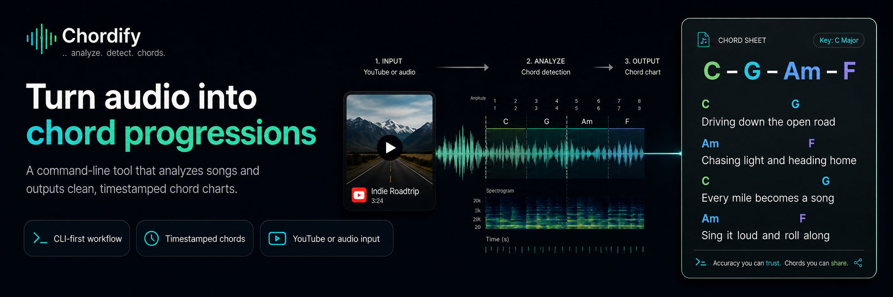

# Chordify



A CLI tool that extracts audio from YouTube videos, transcribes lyrics, and generates chord progressions aligned with the lyrics.

## Why

Mainstream chord-sheet sites cover hit songs well but tend to miss niche material — kids' songs, regional music, older deep cuts, indie releases. The project started from trying to play songs a toddler wanted to sing along with that simply weren't on any cifra site; the only source was YouTube. Chordify closes that gap by deriving the chart directly from the audio.

## Features

- **YouTube Audio Extraction** - Download audio from any YouTube video (with a local cache so each video is fetched only once)
- **Automatic Chord Detection** - CQT/CENS chroma matched against major/minor triad templates, with adaptive bar aggregation, bass-aware Viterbi decoding, key + song-palette priors, and conservative slash/extension display
- **Optional Vocal/Drum Isolation** - Opt-in Demucs (`htdemucs_ft`) stem separation that strips vocals and drums before chroma analysis, keeping only the chord-bearing accompaniment (bass + other). Helps on vocal-heavy recordings where a sung note is otherwise misread as a chord; slower and gated behind the `separation` extra
- **Lyrics Transcription** - Speech-to-text using OpenAI Whisper or NVIDIA Parakeet (word-level timestamps)
- **Aligned Output** - Chord symbols positioned above corresponding lyrics, with sharp/flat respelling and optional `--display-key` / `--capo` transposition
- **Offline Processing** - All processing happens locally, no API keys required

## Architecture

```
┌─────────────────┐    ┌──────────────────┐    ┌──────────────────────┐
│  YouTube URL    │───▶│  Audio Extractor │───▶│  Chord Detector      │
│  (user input)   │    │  yt-dlp + cache  │    │  librosa CQT chroma  │
└─────────────────┘    └──────────────────┘    │  + template matching │
                                               └──────────┬───────────┘
                                                          │
                                                          ▼
                       ┌──────────────────┐    ┌──────────────────────┐
                       │  Lyrics + Chords │◀───│  Lyrics Extractor    │
                       │  (aligned output)│    │  Whisper / Parakeet  │
                       │                  │    │  (word-level timing) │
                       └──────────────────┘    └──────────────────────┘
```

An optional Demucs stem-separation stage can sit between the extractor and the
detector: with `--isolate-instrumental` the mix is split into
drums/bass/other/vocals and only bass + other are recombined for chroma
analysis, removing the vocal melody and drum transients that otherwise pollute
it. See [Optional: vocal & drum isolation](#optional-vocal--drum-isolation).

Audio downloads are cached at `<repo>/.cache/audio/{video_id}.wav` so the same
video is downloaded only once. Pass `--no-cache` to bypass the cache.
Formatted results are printed to stdout or written to `--output-file`; pass
`--repo-copy` to also write a generated copy under `<repo>/outputs/`.

## Accuracy

The detector is tuned against a ground-truth benchmark
(`scripts/chord_eval.py`) that renders pop-style songs — piano comping,
root/fifth bass lines, melody, and drums — from known chord progressions
and scores the detected chords frame-by-frame against the truth. On the
six-song suite (multiple keys, tempos from 74–132 BPM, two-beat changes,
borrowed chords, and a detuned recording) the detector currently scores
**0.98 mean frame accuracy**, and ~0.94 on held-out arpeggiated
arrangements it was not tuned on.

Run it yourself:

```bash
python scripts/chord_eval.py           # full suite
python scripts/chord_eval.py --song fast-d --dump   # detected-vs-truth timeline
```

Synthetic renders are cleaner than real recordings (no vocals, no dense
production), so treat the number as an upper bound — but the same harness
is the fastest way to reproduce and fix failures: add a progression that
matches the song the detector got wrong, run with `--dump`, and iterate.

## Optional: vocal & drum isolation

Chroma-based detection is confused by two things that aren't the harmony: the
sung melody (vocal notes land on non-chord tones) and drum transients
(broadband energy that smears the chroma). Passing `--isolate-instrumental`
(or `detect_chords(..., isolate_instrumental=True)`) runs Demucs' fine-tuned
Hybrid Transformer model (`htdemucs_ft`) to split the track into
drums/bass/other/vocals and feeds only **bass + other** to the chroma stage.
Bass is kept on purpose — the bass note is usually the chord root, and the
detector already scores against a bass-focused chroma, so dropping it removes
the strongest root cue (measured: `other`-only did *not* improve accuracy and
merely relocated the error).

It is **opt-in** because it is not free:

- Requires the `separation` extra and downloads `htdemucs_ft` (~320 MB,
  safetensors) once from the Demucs author's Hugging Face repo.
- Much slower — separation runs four specialist models per track (minutes per
  song, versus seconds for the raw pipeline).
- Separation can introduce its own artifacts, so it is not always a win on
  already-clean recordings.

Measured on the three verified reference charts (chart-vocabulary consistency,
transposition-aware):

| Song | Raw pipeline | `--isolate-instrumental` |
|------|-------------:|-------------------------:|
| Save Tonight | 100.0% | 100.0% |
| Welcome to My Life | 100.0% | 98.5% |
| Senhor Te Quero | 97.4% | ~99% |

The win is removing vocal bleed: Senhor Te Quero's raw pipeline scattered
spurious `Am` chords where the voice held a non-chord tone, and isolation clears
them. Already-clean songs are left unchanged, and separation can cost a little
where it leaves an artifact on a low-information section such as a fade-out —
hence a flag, not the default. (Exact scores drift a point or two run-to-run, as
GPU-accelerated separation naturally does.)

## Installation

```bash
# Clone the repository
git clone https://github.com/yourusername/chordify.git
cd chordify

# Create a virtual environment (Python 3.10–3.12 per pyproject; 3.13 also works
# in practice with librosa 0.11+, but is outside the pinned range)
python3.10 -m venv venv
source venv/bin/activate  # On Windows: venv\Scripts\activate

# Install the package
pip install -e .
```

To enable NVIDIA Parakeet transcription, install the optional NeMo dependencies:

```bash
pip install -e '.[parakeet]'
```

To enable optional Demucs vocal/drum isolation (`--isolate-instrumental`):

```bash
pip install -e '.[separation]'
```

### System Dependencies

On macOS, you may need to install FFmpeg:
```bash
brew install ffmpeg
```

On Ubuntu/Debian:
```bash
sudo apt install ffmpeg
```

## Documentation

| Doc | Description |
|-----|-------------|
| [Usage](docs/usage.md) | Common commands and option examples |
| [CLI Reference](docs/cli-reference.md) | Full flag reference table |
| [Output Formats](docs/output-formats.md) | Lyrics+chords and chords-only output |
| [Transcription Benchmark](docs/transcription-benchmark.md) | Comparing Whisper vs Parakeet |
| [How It Works](docs/how-it-works.md) | Pipeline internals |
| [Technology Stack](docs/technology-stack.md) | Libraries, models, and licenses |

## Notes

- First run will download the selected transcription model.
- `--isolate-instrumental` downloads the Demucs `htdemucs_ft` model (~320 MB,
  safetensors, from the Demucs author's Hugging Face repo) on first use and is
  significantly slower; it requires the optional `separation` extra.
- Python 3.10 is the primary supported runtime (`pyproject.toml` pins
  `>=3.10,<3.13`). 3.13 has worked in practice with `librosa 0.11.0`, but
  isn't pinned — fall back to 3.10/3.11/3.12 if you hit numba/librosa
  import errors.
- Parakeet support requires the optional `parakeet` extra and a model that
  returns word-level timestamps; the default is `nvidia/parakeet-tdt-0.6b-v3`.
- Processing time depends on video length and your hardware.
- GPU acceleration is supported via Whisper's CUDA path if you have CUDA
  installed.
- Extension and slash-chord labels are intentionally conservative; unsupported
  or ambiguous audio falls back to the plain major/minor triad.
- The `outputs/` directory is git-ignored; pass `--repo-copy` if you want
  generated charts persisted there.

## Contributing

Contributions of any size are very welcome — bug reports, feature ideas, doc
fixes, typos, or full pull requests. If you hit a song where the detector
struggles, an issue with the YouTube link is especially helpful since it
gives a concrete failure case to work from.